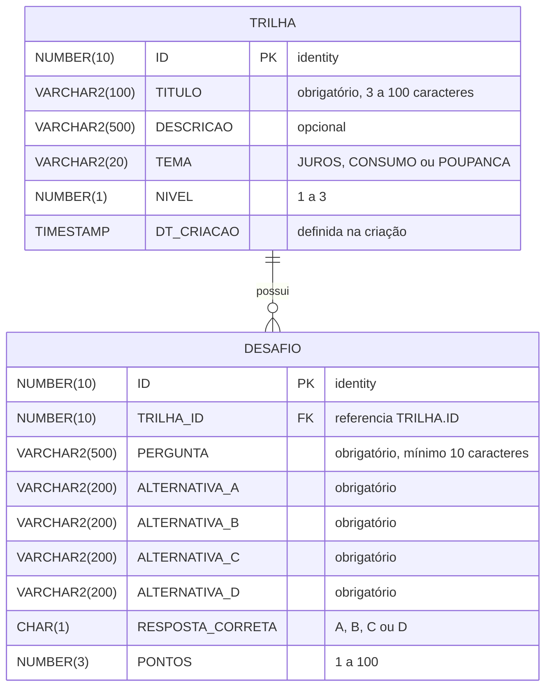

# [Nome do app] — API de Conteúdo Educativo (.NET)

## Integrantes

| Nome | RM | Turma |
|---|---|---|
| Matheus Peres Moraes de Jesus | 567300 | 2TDSPR |
| Cassio Ribeiro | 567295 | 2TDSPR |
| Davi Isac Colin Pereira | 567265 | 2TDSPR |
| Hugo Souza de Jesus | 568542 | 2TDSPR |
| Pedro Gonçalves Rodrigues | 567651 | 2TDSPR |

## Introdução

O endividamento deixou de ser exceção nos lares brasileiros e passou a fazer parte da rotina. Em julho de 2026, 82% das famílias tinham alguma dívida, o maior patamar da série histórica da Pesquisa de Endividamento e Inadimplência do Consumidor (Peic/CNC). Entre as que vivem com até três salários mínimos, o índice chega a 84,9%, e o cartão de crédito, com o rotativo e o parcelamento, aparece como a principal origem do problema. Para essas famílias, a dívida raramente nasce de uma única decisão ruim. Ela se forma no acúmulo de pequenos gastos que ninguém registra, de juros que ninguém calculou e de contas, como a de luz, que só ficam visíveis quando chegam.

A maior parte das ferramentas de finanças pessoais parte do pressuposto de que o usuário tem tempo, familiaridade com planilhas, internet estável e conhecimento prévio sobre juros. Esse não é o retrato de quem mais precisa de ajuda. É nesse espaço que surge o **[Nome do app]**, uma CitizenTech de educação e organização financeira pensada para famílias de baixa renda, com linguagem simples, ícones grandes, recursos de áudio e funcionamento mesmo com conectividade limitada.

A solução se apoia em dois movimentos complementares: aprender e organizar. Na área aberta, sem cadastro, qualquer pessoa joga simuladores curtos sobre juros, compras do dia a dia e poupança, organizados em trilhas por tema e nível de dificuldade. Ao criar uma conta, a família ganha um painel com o **Termômetro do Dinheiro**, que classifica a situação financeira em Verde, Amarelo ou Vermelho conforme o comprometimento da renda, e um plano visual de quitação que prioriza as dívidas com os juros mais altos. Os gastos podem ser registrados por ícones, por voz ou pelo WhatsApp. Um medidor de energia de baixo custo, baseado em ESP32, traduz o consumo elétrico da casa em reais e avisa antes que a conta ultrapasse a meta do mês, transformando um gasto invisível em uma decisão financeira.

O aplicativo é gratuito para as famílias e se sustenta por parcerias com prefeituras e CRAS, cooperativas de crédito, ONGs e distribuidoras de energia, instituições que já atendem esse público e se beneficiam de uma população menos endividada e mais consciente do próprio consumo. A proposta contribui para os ODS 10 (Redução das desigualdades), 4 (Educação de qualidade) e 13 (Ação contra a mudança global do clima). O impacto será medido principalmente pela proporção de famílias que deixam a faixa Vermelha do Termômetro em até três meses de uso.

Esta solução foi desenvolvida para a Global Solution 2026/2 do curso de Análise e Desenvolvimento de Sistemas da FIAP. Ela é composta por entregas integradas: uma API principal em Java, uma API de conteúdo educativo em .NET, o aplicativo em Flutter, a camada de processamento em PL/SQL, o medidor IoT e a infraestrutura em nuvem no Azure.

## Sobre este repositório

Este repositório contém a **API de conteúdo educativo** do [Nome do app], desenvolvida em ASP.NET Core 8 com Entity Framework Core e banco de dados Oracle. Ela cadastra e disponibiliza as trilhas de aprendizagem, como "Fugindo dos Juros" e "O Desafio do Supermercado", e os desafios de múltipla escolha que compõem cada uma delas, modelados em uma relação 1:N. Esses dados alimentam os jogos da área aberta do aplicativo: cada desafio traz a pergunta, as alternativas, a resposta correta e a pontuação que a família acumula ao jogar. Manter o conteúdo educativo em uma API própria permite publicar, revisar ou ter trilhas patrocinadas por parceiros sem alterar o aplicativo nem a API de dados financeiros.

## Relação com as demais entregas

Esta API fornece o conteúdo dos jogos da área aberta do aplicativo Flutter, exibidos na tela Jogo/Simulador. Nesta fase, o aplicativo usa dados mockados com os mesmos campos de Trilha e Desafio expostos aqui.

A API Java é a API principal da solução: cuida de usuários, transações, dívidas e energia, e é ela que roda em containers na entrega de DevOps. As duas APIs aparecem na camada de Aplicação do diagrama ArchiMate.

O banco da entrega de PL/SQL usa outras tabelas, em outro schema, e não se confunde com as tabelas `TRILHA` e `DESAFIO` deste projeto.

## Tecnologias

- ASP.NET Core 8 (Web API com controllers, `net8.0`)
- Entity Framework Core 8.0.33 (`Microsoft.EntityFrameworkCore` e `Microsoft.EntityFrameworkCore.Design`)
- Oracle.EntityFrameworkCore 8.23.26400
- Oracle Database da FIAP
- Migrations do EF Core para criar as tabelas e a carga inicial
- Swagger (Swashbuckle.AspNetCore 6.6.2) e Scalar (Scalar.AspNetCore 2.19.0) para a documentação interativa

## Modelo de dados



Uma trilha possui vários desafios e cada desafio pertence a exatamente uma trilha (1:N), pela chave estrangeira `DESAFIO.TRILHA_ID`. A FK foi criada com `ON DELETE CASCADE`, então remover uma trilha remove também os desafios dela.

## Endpoints

| Verbo | Rota | Descrição | Sucesso | Erros |
|---|---|---|---|---|
| GET | `/api/trilhas` | Lista todas as trilhas, com a quantidade de desafios de cada uma | 200 | — |
| GET | `/api/trilhas/{id}` | Busca uma trilha pelo id | 200 | 404 |
| GET | `/api/trilhas/{id}/desafios` | Lista os desafios de uma trilha | 200 | 404 (trilha inexistente) |
| POST | `/api/trilhas` | Cria uma trilha | 201 | 400 |
| PUT | `/api/trilhas/{id}` | Atualiza uma trilha | 204 | 400, 404 |
| DELETE | `/api/trilhas/{id}` | Remove uma trilha e os desafios dela | 204 | 404 |
| GET | `/api/desafios` | Lista os desafios; aceita o filtro opcional `?trilhaId=` | 200 | — |
| GET | `/api/desafios/{id}` | Busca um desafio pelo id | 200 | 404 |
| POST | `/api/desafios` | Cria um desafio em uma trilha existente | 201 | 400 (dados inválidos ou trilha inexistente) |
| PUT | `/api/desafios/{id}` | Atualiza um desafio | 204 | 400 (dados inválidos ou trilha inexistente), 404 |
| DELETE | `/api/desafios/{id}` | Remove um desafio | 204 | 404 |

Listas vazias respondem 200 com `[]`. Todo erro tem corpo JSON no formato `{ "erro": "mensagem" }`.

## Como executar

### Pré-requisitos

- .NET 8 SDK, ou um SDK mais novo com o runtime ASP.NET Core 8 instalado.
- Ferramenta `dotnet-ef` 8.x:

  ```bash
  dotnet tool install --global dotnet-ef --version 8.0.*
  ```

- Acesso ao Oracle da FIAP (usuário e senha).

### Passo a passo

1. Clone o repositório e entre na pasta:

   ```bash
   git clone https://github.com/MaThPMJ/trilhas-api.git
   cd trilhas-api
   ```

2. Configure a connection string. A senha fica fora do repositório: o `appsettings.json` traz apenas um valor de exemplo, e o valor real é guardado pelo `user-secrets` na sua máquina.

   ```bash
   dotnet user-secrets set "ConnectionStrings:OracleConnection" "User Id=SEU_RM;Password=SUA_SENHA;Data Source=oracle.fiap.com.br:1521/ORCL"
   ```

   Como alternativa, defina a variável de ambiente `ConnectionStrings__OracleConnection` com o mesmo valor:

   ```powershell
   $env:ConnectionStrings__OracleConnection = "User Id=SEU_RM;Password=SUA_SENHA;Data Source=oracle.fiap.com.br:1521/ORCL"
   ```

   ```bash
   export ConnectionStrings__OracleConnection="User Id=SEU_RM;Password=SUA_SENHA;Data Source=oracle.fiap.com.br:1521/ORCL"
   ```

3. Aplique as migrations. Este comando cria as tabelas `TRILHA` e `DESAFIO` e insere a carga inicial (3 trilhas e 12 desafios):

   ```bash
   dotnet ef database update
   ```

4. Suba a API:

   ```bash
   dotnet run --launch-profile http
   ```

5. Abra a documentação interativa no Scalar: <http://localhost:5099/scalar/v1>. O Swagger UI também fica disponível em <http://localhost:5099/swagger>.

## Como testar

### Pelo Scalar

Com a API no ar, abra <http://localhost:5099/scalar/v1>, escolha um endpoint, preencha os dados e envie a requisição pela própria página.

### Pelo arquivo TrilhasApi.http

O arquivo `TrilhasApi.http`, na raiz, traz requisições prontas para todos os endpoints, incluindo os casos de 400 e 404. Ele pode ser executado pelo Visual Studio ou pelo VS Code (extensão REST Client). Execute as requisições na ordem do arquivo: as que usam um id dependem da resposta de `criarTrilha` e `criarDesafio`.

### Exemplos de corpo

`POST /api/trilhas`

```json
{
  "titulo": "Fugindo dos Juros",
  "descricao": "Entenda como os juros do cartão fazem a dívida crescer.",
  "tema": "JUROS",
  "nivel": 1
}
```

`tema` aceita `JUROS`, `CONSUMO` ou `POUPANCA`; `nivel` vai de 1 a 3.

`POST /api/desafios`

```json
{
  "trilhaId": 1,
  "pergunta": "O que acontece quando você paga só o valor mínimo da fatura?",
  "alternativaA": "A dívida some no mês seguinte",
  "alternativaB": "O resto da fatura vira dívida com juros altos",
  "alternativaC": "O banco dá um desconto na próxima fatura",
  "alternativaD": "O limite do cartão aumenta sozinho",
  "respostaCorreta": "B",
  "pontos": 10
}
```

### Exemplos de erro

400 — dados inválidos (`POST /api/trilhas` com título de 2 caracteres):

```json
{
  "erro": "Dados inválidos.",
  "detalhes": {
    "Titulo": ["O título deve ter entre 3 e 100 caracteres."]
  }
}
```

400 — regra de negócio (`POST /api/desafios` com `trilhaId` que não existe):

```json
{
  "erro": "Trilha informada não existe."
}
```

404 — id inexistente (`GET /api/trilhas/99999`):

```json
{
  "erro": "Trilha 99999 não encontrada."
}
```

### Conferindo os dados no Oracle

```sql
SELECT t.ID,
       t.TITULO,
       t.TEMA,
       t.NIVEL,
       d.ID AS DESAFIO_ID,
       d.PERGUNTA,
       d.RESPOSTA_CORRETA,
       d.PONTOS
  FROM TRILHA t
  JOIN DESAFIO d ON d.TRILHA_ID = t.ID
 ORDER BY t.ID, d.ID;
```

## Vídeo

LINK_DO_VIDEO
